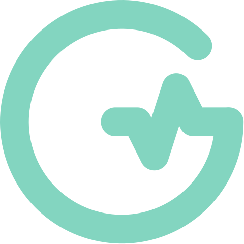
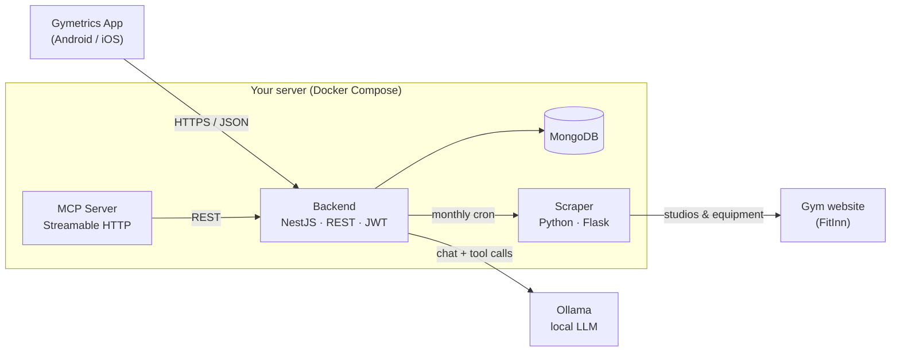
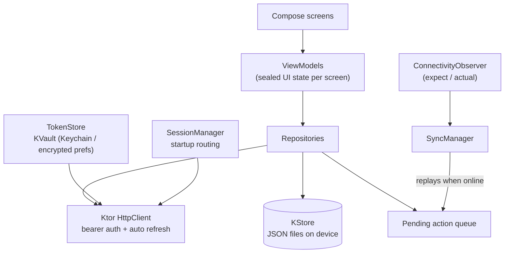

<p align="center">
  
</p>

<h1 align="center">Gymetrics</h1>

<p align="center">
  A self-hosted workout tracker for Android and iOS.<br/>
  You run the backend and AI Service on your own server, the app talks to it, and your training data stays with you.
</p>

<p align="center">
  <a href="https://github.com/Jakob-ui/Gymetrics_App/releases">Download APK</a> ·
  <a href="https://github.com/Jakob-ui/Gymetrics-Backend">Backend repo</a> ·
  <a href="https://gymetrics.at">gymetrics.at</a>
</p>

This repo is the mobile app. The backend (NestJS, MongoDB, a Python scraper and the AI agent) lives in Gymetrics-Backend.


### Why I built this.

Mostly I've built it as an University Project to learn more about Hybrid Mobile Developement with Kotlin Multiplatform. Also as someone with an IT-background from my bachelorsdegree, I know how many applications are not very secure and respect your data. For this reason I startet out to create a rather simple looking Frontend App that can connect to a backend and database runnning on ones own server. In late August 2026 I started the app, which was also the first time I wrote Kotlin. I had never used Kotlin Multiplatform before either, so a big part of this project was figuring out how KMP actually works: source sets, expect/actual, coroutines, Compose state. It was very important for me to also have a caching option to also read Data when my device is offline.


### What it does

Connect to your own server. On first launch you enter your server URL (via a registered Domain or just use a VPN). The app pings it and checks that the response really comes from a Gymetrics backend, not just that it returns a 200 (pretty much everything returns 200). For not that tech savy persons I also provide a ready made solution under "app.gymetrics.at", which defeats the purpose a little bit, but is handy to just try the app.
Then you can log in (or register an account). Access and refresh tokens are stored in the platform's secure storage, and expired tokens are refreshed automatically.
Templates. Then you can Build workout templates (even with AI if you've configured it that way) with exercises, target reps and weights.
For helping with generating templates with AI you can add personal information about yourself in the personal settings and pick your gym. The backend then runs an LLM loop and calls a local LLM (via Ollama) to build a plan based on your recent trainings, your biometric Data and the machines your gym actually has.
You then can schedule trainings from your templates on specific days and see them in a month view.
As mentioned before everything works offline. Everything you've loaded is cached on the device. Creating, deleting and completing trainings also works offline and syncs once you're back online.


### Architecture



The app only ever talks to the backend. The backend stores everything in MongoDB, and once a month it asks the scraper service to pull the list of gyms and their equipment from the FitInn website. When you generate a template with AI, the backend sends your request to Ollama together with two tools the model can call itself: one that loads your recent trainings and one that loads the equipment of your gym. The MCP server exposes the same kind of data over the Model Context Protocol, so other MCP clients can use it too. (I know, defeats the purpose of the self contained data, but it was fun to learn how MCPs work)

A more detailed diagram with the data model is in the [backend repo](https://github.com/Jakob-ui/Gymetrics-Backend)

### Inside the app


The app follows MVVM. Most features have their own folder under ui/ with a screen, a ViewModel and a sealed State class. ViewModels never touch the network directly. They go through repositories, which decide whether to serve cached data, fetch fresh data, or queue a write for later. Everything is wired together with Koin (to take advantage of dependency injection).

```
shared/src/
├── commonMain/    ← about 97% of the code: UI, ViewModels, repositories, networking, sync
├── androidMain/   ← platform bits: secure storage, connectivity, dynamic color, status bar
└── iosMain/       ← the same for iOS
androidApp/        ← Android entry point
iosApp/            ← iOS entry point (Xcode project)
```


### Decisions I made and why

Kotlin Multiplatform with a shared Compose UI. One codebase for Android and iOS, including the UI. I choose this framework because i think it's very interesting. It compiles natevily on iOS and runs in a JVM on Android. Also it was a good oportunity to learn Kotlin.

In the beginning I startet with reading some documentation and creating just the welcome screen and the state machine behind the JWT token storage logic and the http interceptor with Ktor. I decided not to use dependency injection right at the start to understand the fundamentals, but of course planned to use it later. I wanted to understand the problem before using a tool that solves it.

Of course I also use AI to help me with coding but decided to conduct a little experiment with a M4 mac i had laying around. So I installed [OMLX](https://omlx.ai/) as a solution to host local models on the mac and equiped it with a vpn so I could call the api even when I'm not at home. Then i combined a quantized Qwen3-Coder model with a [Context7](https://context7.com/) mcp connector using the current kmp documentation to provide me with uptodate coding solutions. That worked actually great for the early stages of the developement process, as a fronted wrapper I ran the sadly no longer maintained cscode extention continue, because it provided me with every tool I needed. Sadly VS-Code doesnt actually provide good robust support for locally hosted coding models and I didn't want to use some agentic tool like open code. After a little bit of time developing with my setup the context got to big for my 16gb macbook and i had to switch to claude.

#### For storing different things I chose: 

* Tokens in secure storage, not in settings. Access and refresh tokens go into KVault, which uses the Keychain on iOS and encrypted storage on Android. 
* Normal preferences (theme, server URL) go into plain settings. 

* Offline cache with KStore instead of a database. My original plan was SQLDelight. I ended up storing the API responses as JSON files with KStore, one file per resource to keep it simple for caching purposes and time reasons.

* A queue for offline writes. If you create, delete or complete a training while offline, the action is stored in a persistent queue (a sealed PendingAction type saved to storage). The SyncManager listens for connectivity changes and replays the queue in order once you're back online. If one action fails, it stops there instead of skipping ahead, because the order matters (you can't complete a training the server doesn't know about yet). 

#### AI implementation

AI generation runs in the background. Small local models are slow, and the app uses a 10 second request timeout. So the backend answers right away with a template marked as generating and does the actual work in the background. The app checks every 3 seconds until it's done, and you can leave the screen in the meantime.

Tech stack

​
​
Language
Kotlin 2.4
UI
Compose Multiplatform 1.11, Material 3, type-safe Navigation Compose
Networking
Ktor client 3.5 (content negotiation, bearer auth, logging)
DI
Koin 4.2
Local storage
KStore (cache, offline queue), KVault (tokens), Multiplatform Settings
Other
kotlinx.serialization, kotlinx.datetime, coroutines / StateFlow, Reorderable
CI
GitHub Actions: builds the APK and publishes a release for every v* tag
Backend
NestJS, MongoDB, Python (Flask), Ollama, MCP, Docker. See the backend repo


What I'd do differently

<!-- TODO: These come from your Notion "App Code Tasks". Rephrase them how you'd say it.
     This section shows you can look at your own code critically, which is good for applications. -->

The caching logic is duplicated. Every repository has its own version of "load from cache, fetch, write back". I'd pull that into one generic helper.
The refresh flow needs another look. Token refresh happens in two places (on app start in SessionManager and in the Ktor auth plugin), and there's still a bug in there.
Only one gym chain is supported. The scraper only knows FitInn right now.
<!-- TODO: Anything else? e.g. tests, iOS testing, error handling -->


What's next

Different workout modes, e.g. going through exercises one by one with a running timer
Time tracking per workout
Support for more gyms
Invalidating JWTs on logout (blacklist on the backend)
Icons for templates
An easier way to move a training to another day
<!-- TODO: Statistics and an admin panel are also in your Notion. Add them if they're still planned. -->


Running it

1. Backend. You need a running Gymetrics backend first. Setup with Docker Compose is described in the backend repo. There's also a compose generator on gymetrics.at.

2. App.​

Android: download the latest APK from Releases. Needs Android 14 or newer.
Build it yourself:​
bash```bash
./gradlew :androidApp:assembleDebug
iOS: open iosApp/ in Xcode and run it from there.
<!-- TODO: Is iOS tested? If not, say so honestly, e.g. "iOS builds, but I've mostly tested on Android." -->

On first launch, enter your server URL, then register.


<!-- TODO: Your name + links. Delete what you don't want. -->
Made by Jakob · LinkedIn · GitHub
